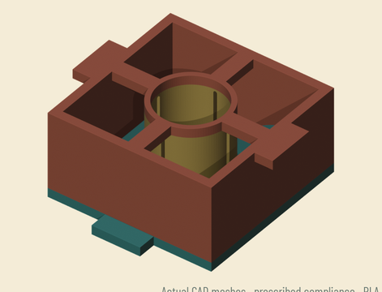
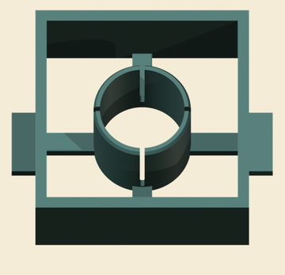
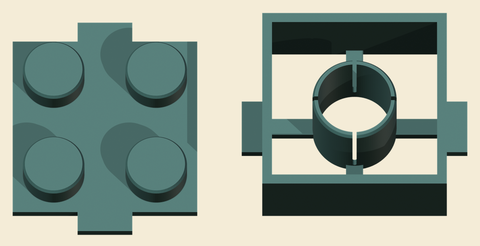
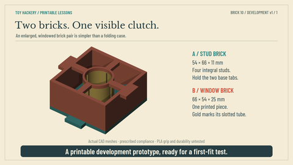
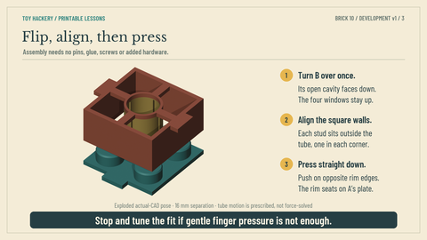
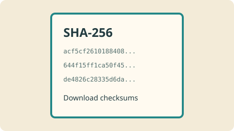

# Toy Hackery Pilots

Small mechanical toy films and printable lesson prototypes.

**Pilot 10 is the first downloadable print package in this repository.** The other pilots are listed below for the collection; their files have not been uploaded here.

## Print Pilot 10: windowed building brick

A complete enlarged two-piece stud-and-tube brick pair with viewing windows and pull tabs. No added hardware. Both parts fit on one 133 × 66 × 25 mm plate.

### Downloads at a glance

Select a thumbnail or filename to open its download. Model previews are taken from the included CAD-based guide; they are not photos of a physical print.

| Preview | File |
|:---:|:---|
|  | **[Complete Pilot 10 package](https://github.com/yury-g/Toy-Hackery-Pilots/releases/download/pilot-10-v1/Toy-Hackery-Brick-Printable-v1.zip)** Editable sources, models, guide, video and verification records. |
|  | **[Stud brick STL](https://github.com/yury-g/Toy-Hackery-Pilots/releases/download/pilot-10-v1/StudBrick.stl)** Print flat, studs upward. |
|  | **[Window brick STL](https://github.com/yury-g/Toy-Hackery-Pilots/releases/download/pilot-10-v1/WindowBrick.stl)** Print flat, cavity and tube upward; flip after printing. |
|  | **[One-plate layout STL](https://github.com/yury-g/Toy-Hackery-Pilots/releases/download/pilot-10-v1/One-Plate-Layout.stl)** Both parts positioned for printing. |
|  | **[Assembly and disassembly guide](https://github.com/yury-g/Toy-Hackery-Pilots/releases/download/pilot-10-v1/Visual-Assembly-and-Disassembly.pdf)** Six-page illustrated PDF. |
|  | **[CAD operation preview](https://github.com/yury-g/Toy-Hackery-Pilots/releases/download/pilot-10-v1/Brick-CAD-Operation.mp4)** Watch the mechanism in motion. |
|  | **[SHA-256 checksums](https://github.com/yury-g/Toy-Hackery-Pilots/releases/download/pilot-10-v1/SHA256SUMS.txt)** Verify the six downloadable assets. |

For multiple colors, import the **two individual manufacturing STLs**, assign a loaded PLA-family color to each whole part, and keep both supplied print orientations. The gold tube in the preview is a teaching color within the single WindowBrick part; it is not another piece to print separately.

### Starting settings

220 mm printer baseline; PLA / PLA+ / PLA Pro; 0.4 mm nozzle; 0.2 mm layers; four walls; 20% infill; supports off. Use your own printer's profile and loaded material settings. The package contains no printer-ready G-code or calibrated Snapmaker project.

The native CAD and STL/STEP exports passed geometry checks. A reference slice preserved the tube slots without generated supports. **This is a development prototype: physical fit, holding force, wear and durability remain untested.** Follow the guide's first-fit and tuning steps. The included generic reference machine settings are evidence only; do not use them in place of your own machine profile.

## Pilot collection

| Pilot | Mechanism | Files hosted here |
|---|---|---|
| 01 | Wind-up toy car | Not uploaded |
| 02 | Walking spring / Slinky | Not uploaded |
| 03 | Click-stop doll knee | Not uploaded |
| 04 | Crank-driven walking horse | Not uploaded |
| 05 | Coupled-leg walking doll | Not uploaded |
| 06 | Pull-string talking doll | Not uploaded |
| 07 | Sleeping doll eyes | Not uploaded |
| 08 | Jack-in-the-box release latch | Not uploaded |
| 09 | Cylinder music box | Not uploaded |
| 10 | Stud-and-tube building brick | [Download v1](https://github.com/yury-g/Toy-Hackery-Pilots/releases/tag/pilot-10-v1) |

The Pilot 10 mechanism is grounded in [Godtfred Kirk Christiansen's US3005282A](https://patents.google.com/patent/US3005282A/en). The windowed roof, pull tabs, enlarged dimensions and FDM fit are teaching modifications.

Bundled fonts retain their included SIL Open Font License notices. No additional license has been assigned to the original CAD or artwork in this initial upload.
